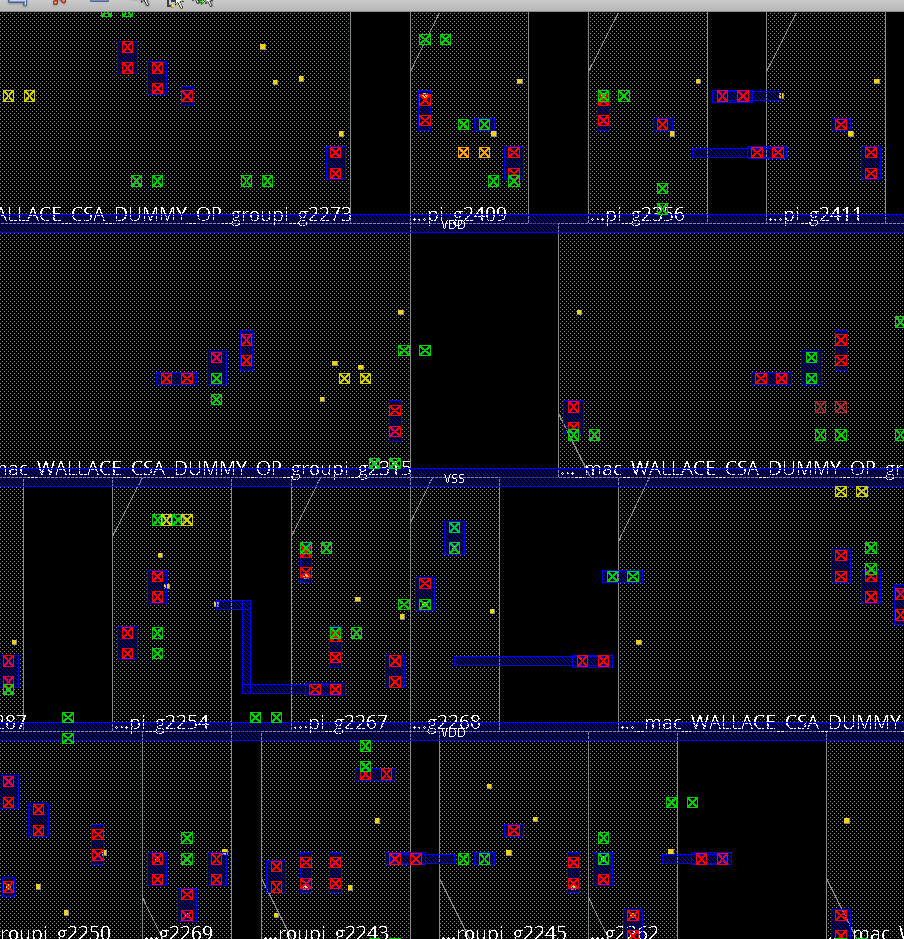
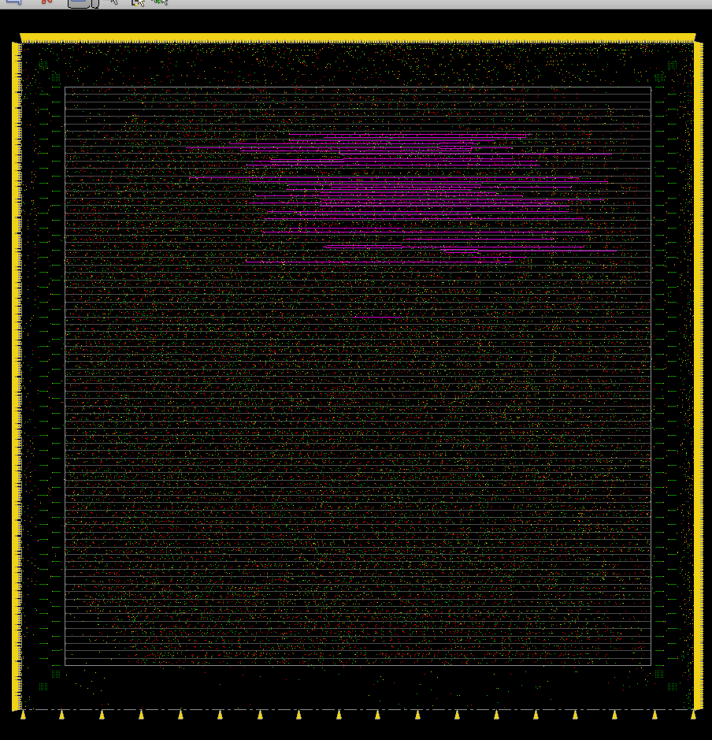
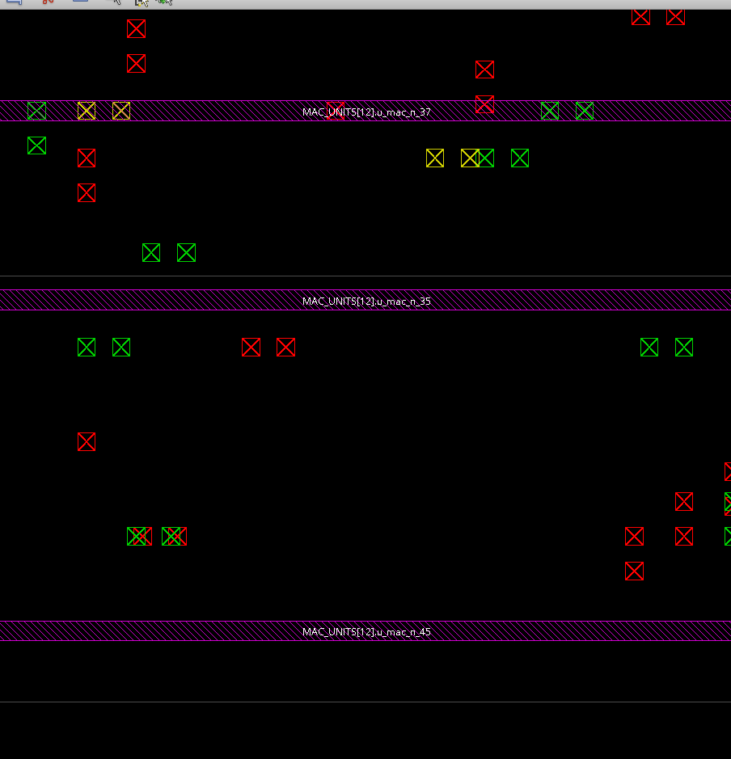
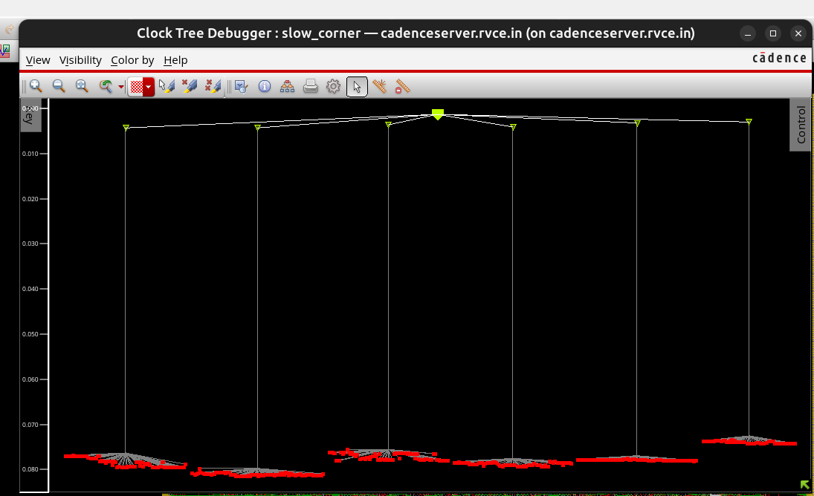
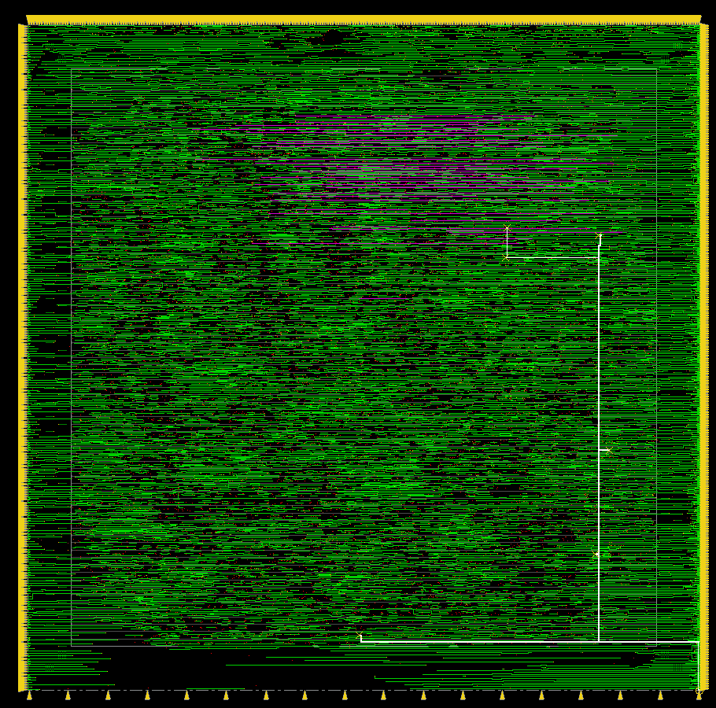
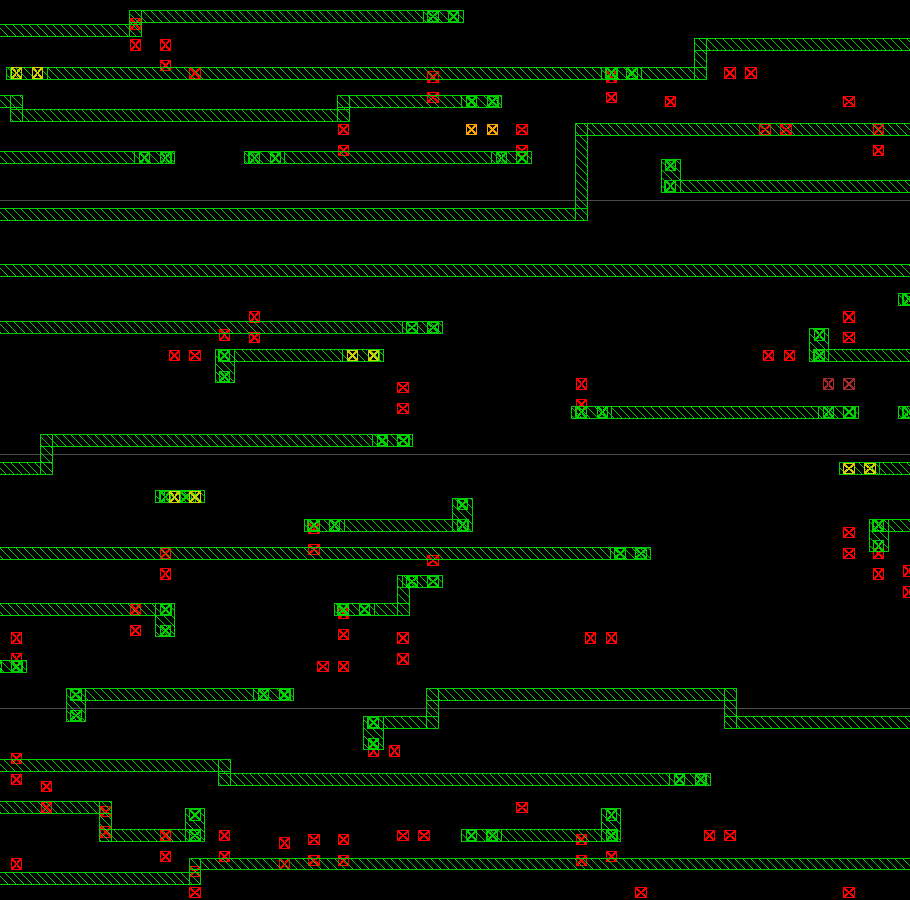
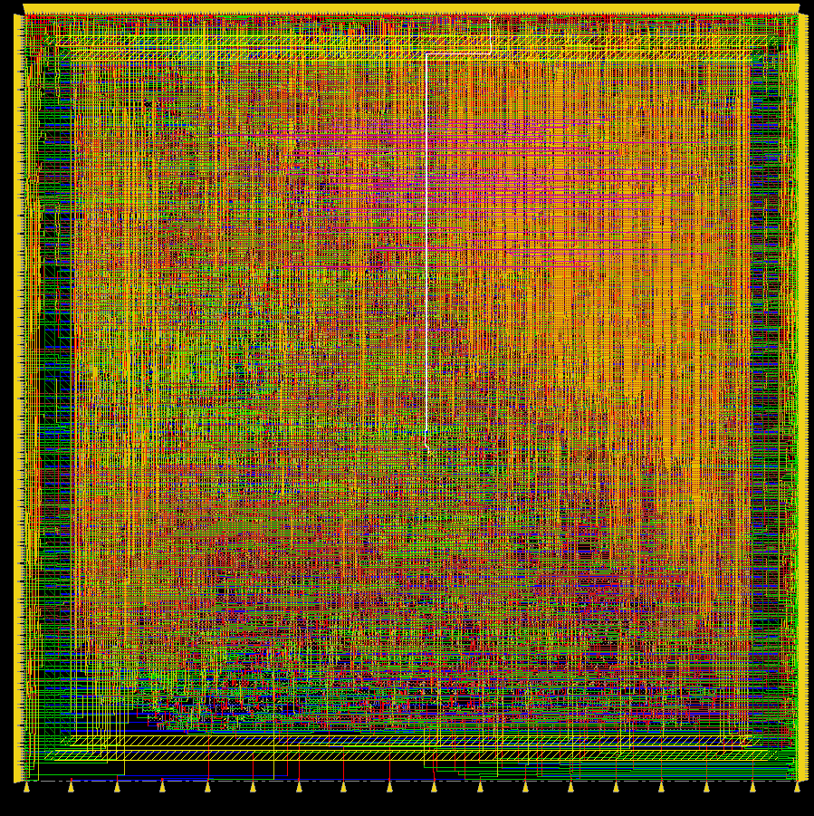

# Layout gallery (Innovus 21.15 GUI), grouped by flow step

## Step 1: Placement (`place_design`)
Standard cells are legalized in rows. The 16 MAC units show up as separate clusters, with the VDD/VSS ring and M1 rails around them.

*01: Whole die after placement. Ring and power rails visible, 16 MAC clusters, empty channels between them.*

*02: Zoom on cell rows, with VDD/VSS rails labelled and Wallace-tree CSA cells (the synthesized multiplier).*

*03: GUI view of the `s4_place.enc.dat` checkpoint (title bar) with the layer panel used to show/hide layers.*

## Step 2: Clock tree synthesis (`ccopt_design`)
The magenta nets are the clock tree.

*04: Die overview with I/O pins on the edges and clock nets in magenta.*

*05: Zoom on cell rows (`MAC_UNITS[12]...`) with via/pin markers.*

*06: Clock Tree Debugger: one root driving 6 leaf-level buffers/clusters, roughly 0.08 ns insertion delay, 512 flop sinks, balanced skew.*

## Step 3: Routing (`routeDesign`)

*07: Routed die, power ring/rails plus signal wiring.*

*08: Zoom showing cells and via cuts (Via1 red, Via2 green, Via3 yellow).*

*09: Signal routing only, horizontal wires on one layer (green), long clock nets in magenta.*

*10: Zoom on detailed routes: wire segments with vias between layers.*

*11: Final routed design, all metal layers visible (M1-M11). 0 DRC, 0 antenna violations.*

## Not captured yet
Floorplan-only and power-plan-only screenshots, and the final filler/GDS views. To capture them, restore the checkpoints `s1_floorplan` and `s2_power` (see `docs/04_commands_cheatsheet.md`) and screenshot each one.
